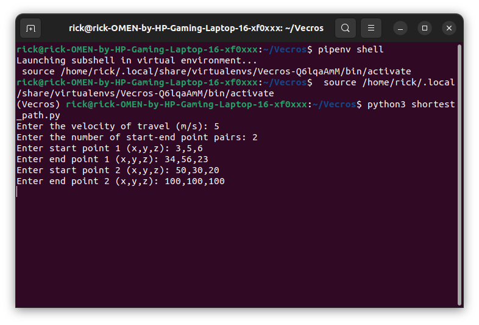
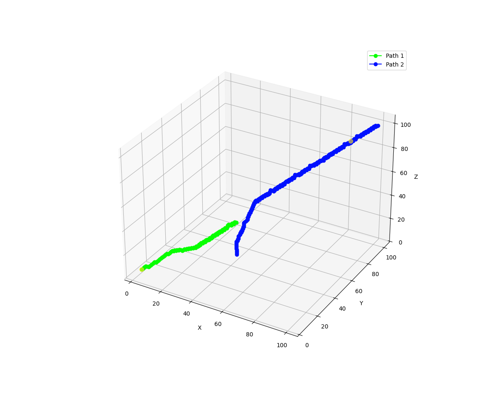
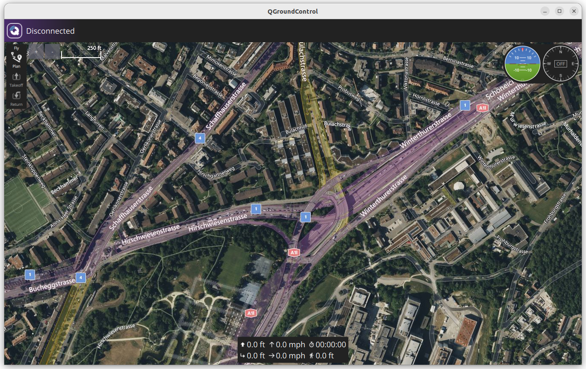
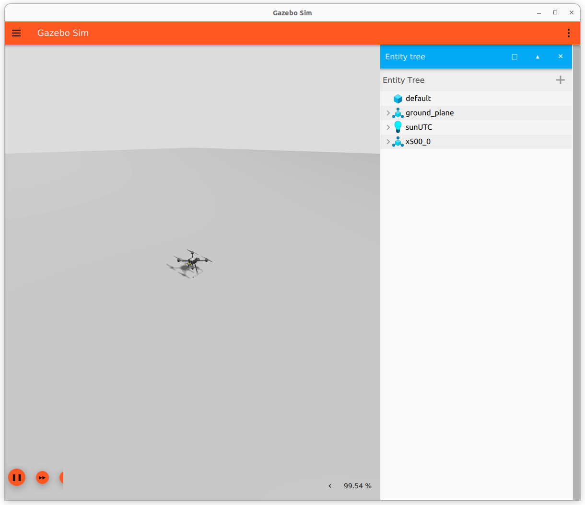
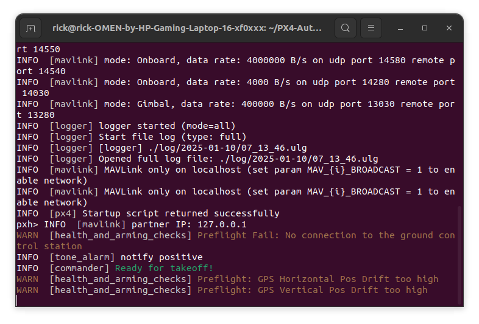
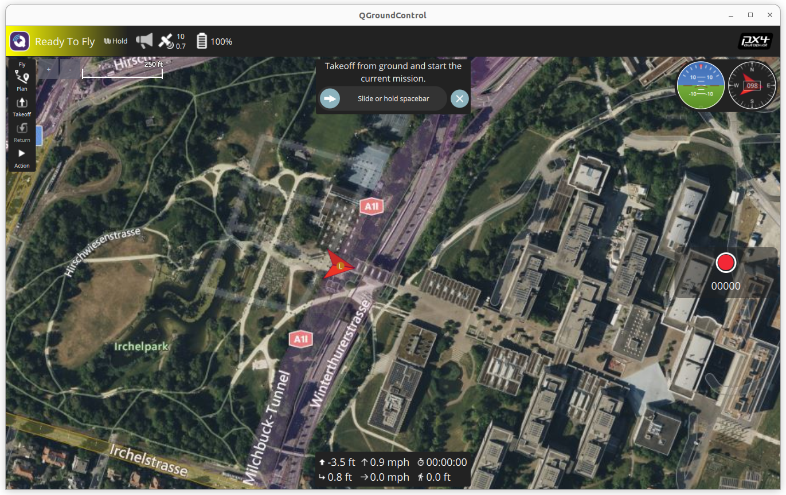
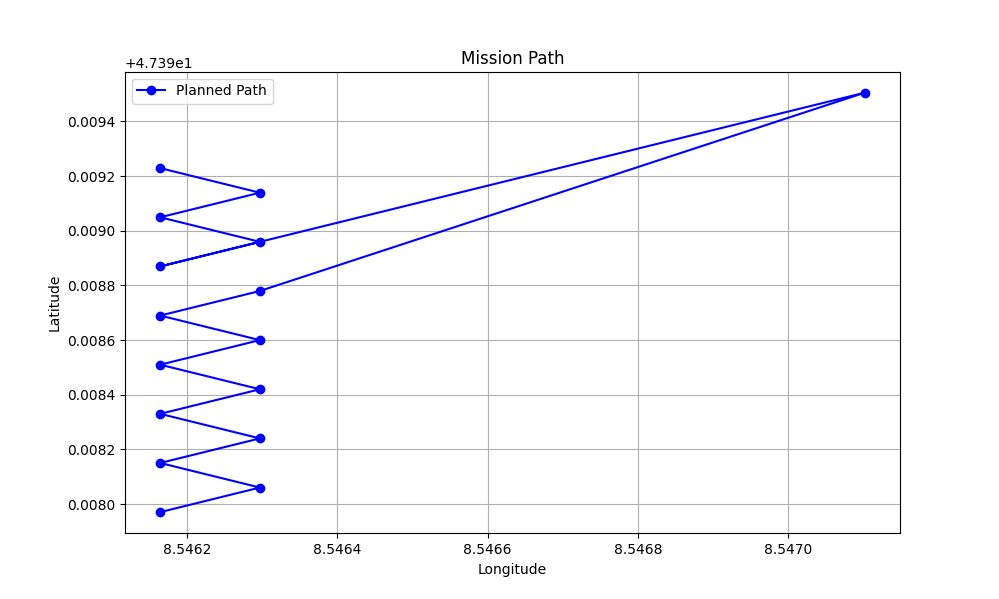
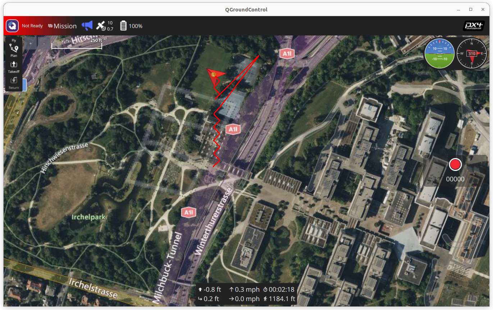

# Mission_Planner

# System Specifications on which code is tested

- Ubuntu 22.04
- Python 3.10

# Libraries to Install
The following libraries need to be installed for the following specific tasks

1. For finding the shortest path in 3D from randomly weighted points
- numpy
- seaborn
- matplotlib
- networkx

2. For mission planner with waypoints

- pymavlink
- dronekit
- matplotlib

# Frameworks used for mission planner

- **PX4** (For ROS2 and Ubuntu 22.04, it can be installed from [here](https://docs.px4.io/main/en/ros2/user_guide.html))

- **QGroundControl** (AppImage attached with this repository)

# Description of the files

- **VECROS_Tasks.pdf:** Contains the details of the algorithms and procedures used for mission planning and shortest path in 3D

- **shortest_path.py:** Contains the code for finding the shortest path

- **mission_planner.py:** Contains the code for mission planning for the given waypoints and outputs the estimated time and distance remained for the mission at every instance in the terminal. 

- **mission_planner2.py:** Contains the code for mission planning for the given waypoints and outputs the elapsed time and estimated distance till the next waypoint after reaching each waypoint.

# Running the Shortest path code

- Clone the repo
- Open the terminal in the cloned folder
- Create a virtual environment or download the above mentioned libraries
- Type the following code in the terminal
    ```
    python3 shortest_path.py
    ```
- The terminal would ask for the start point, number of start and end pairs you want to provide and then each start and end pair. Provide each coordinate seperated by a comma as given in the picture below

- After some time the terminal will show the shortest time for each path as shown below

- The graph is an interactive graph and looks somewhat like as shown below


# Running the Mission Planner Code

- Clone the repo
- Open the terminal in the cloned folder
- Download PX4 and the above libraries given above
- Run QGround Control with the following code 
    ```
    ./QGroundControl.AppImage
    ```
- The QGround control window will open up and it should show disconnected as shown below

- Open Another terminal or another tab in same terminal and navigate to the PX4 folder and type the following command
    ```
    make px4_sitl gz_x500
    ```
    Gazebo simulator window should open up as follows
    
    And since QGroundControl was already open up the PX4 should be ready to takeoff and terminal in which PX4 was run should show like the below
    
    The QGround Control window should now show Hold mode as shown below and should be ready to fly
    

- Now open another terminal or another tab in the same terminal and navigate to the folder of this cloned repository and type the follow command
    ```
    python3 mission_planner.py
    ```
    Or,
    ```
    python3 mission_planner2.py
    ```

- Now the path will be covered as specified and finally a graph gets plotted in matplotlib as well as the path will be shown in QGC as follows


- Finally the drone Lands in the last waypoint
Below is a video demonstration of the drone's movement as well as the terminal outputs simulataneously
(/Video/Drone_movement.mp4)

**Note:** The time is calculated based on the current ground speed, so while taking off or changing direction when the ground speed changes, the time increases quite a lot, stabilised time can be found while the drone is in motion from one way point to other.
